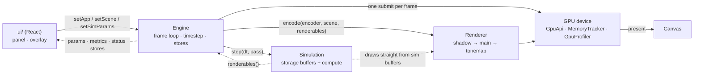
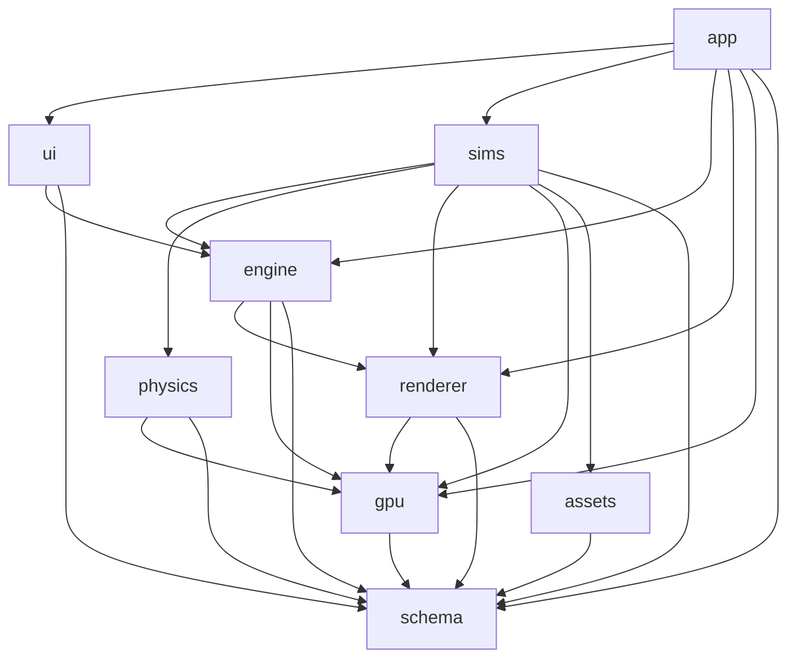
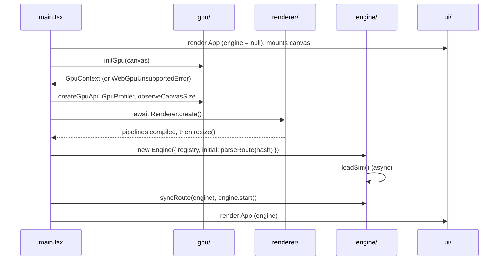
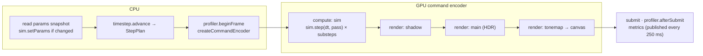
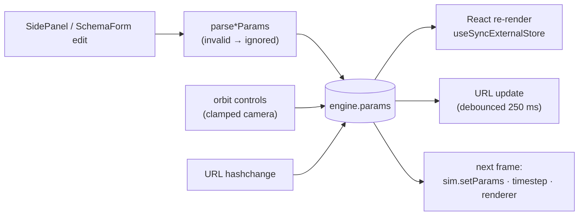
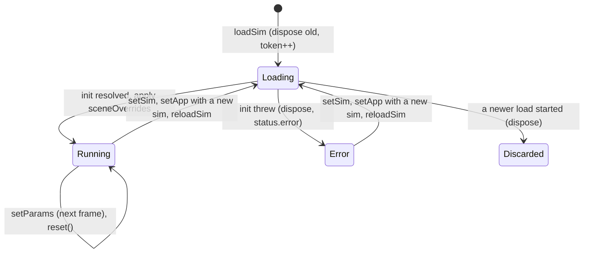
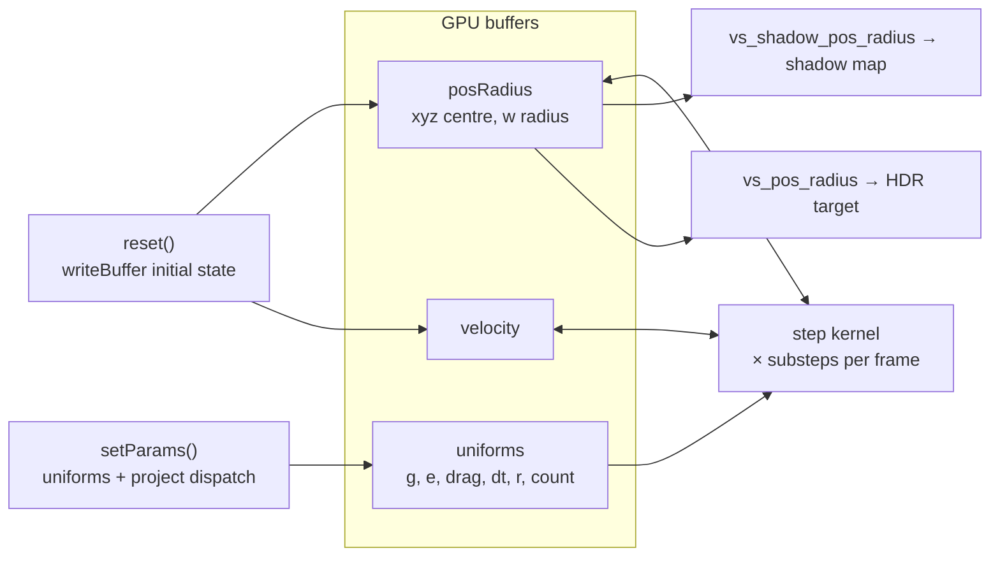
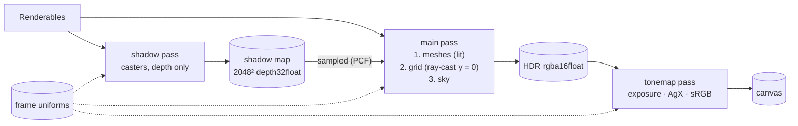

# Architecture

How the sandbox fits together: the layers, what happens on each frame, how state flows, and the
contracts a simulation implements. For setup and scripts, see the [README](README.md).

This document describes structure and intent. Exact signatures live in the source, with doc
comments; follow the links rather than copying code here.

## The big picture

Everything visual is raw WebGPU. A React panel sits on top of a single canvas.



Solid arrows are calls; dotted arrows are data the receiver reads.

- **Schemas are the source of truth.** Every tweakable value is declared once, in zod, with a
  default, a range and a label. That one declaration gives TypeScript types, validation, defaults
  and a JSON Schema that the UI builds its controls from.
- **The engine owns time.** It runs the frame loop and a fixed-timestep accumulator, owns the
  current simulation, and exposes state through observable stores.
- **A simulation owns its GPU state.** It creates storage buffers, records compute dispatches into
  a pass the engine opens, and describes what to draw as `Renderable`s pointing at those buffers.
  Simulation state never comes back to the CPU.
- **The renderer owns every render pass.** Sims never open render passes or touch the canvas.
- **The UI never sees the GPU.** It reads engine stores and writes through validated engine
  methods, so React stays out of the frame loop.

## Layers

Each folder under `src/` is a layer with a public `index.ts`. An arrow means "may import".



| Layer      | Owns                                                                                  |
| ---------- | ------------------------------------------------------------------------------------- |
| `schema`   | Zod schemas, defaults, parsing, JSON Schema export. The only place zod is imported.   |
| `gpu`      | Device setup, canvas sizing, labelled resource creation, memory tracking, GPU timings |
| `renderer` | Every render pass, meshes, camera maths, sky, lighting and shadow shaders             |
| `physics`  | Reusable solvers (empty for now)                                                      |
| `assets`   | Asset loading (empty for now)                                                         |
| `engine`   | Frame loop, timestep, sim lifecycle, orbit controls, stores, metrics                  |
| `sims`     | One folder per simulation                                                             |
| `ui`       | React components                                                                      |
| `app`      | Composition root: startup, sim registry, URL routing. Nothing imports it.             |

[`.dependency-cruiser.cjs`](.dependency-cruiser.cjs) enforces these rules in `npm run check`.
Beyond the layer arrows it also enforces:

- cross-layer imports go through a layer's `index.ts` (or `sims/<name>/index.ts`)
- zod only in `schema/`; React only in `ui/` and `app/`
- no sim imports another sim; nothing imports `app/`; no cycles

To draw the actual import graph between layers:

```sh
npx depcruise src --include-only '^src' --collapse '^src/[^/]+/' --output-type mermaid
```

## Startup

[`src/app/main.tsx`](src/app/main.tsx) creates the canvas before the GPU is ready, so React can
mount it straight away.



If anything before the last step throws, the app shows a fatal screen instead. A lost device does
the same later on. The first frames can run before the sim has loaded; they draw only sky and grid.

## One frame

`Engine.frame()` in [`src/engine/engine.ts`](src/engine/engine.ts) records everything into one
command encoder and submits once.



The engine opens the `sim` compute pass whenever a sim is loaded, even when no steps are due, so
the pass timing in the overlay stays continuous. Each pass gets a timestamp pair from
[`GpuProfiler`](src/gpu/profiler.ts). Timings are read back through a ring of buffers so a frame
never waits, which means they lag by a frame or two.

### Timestep

[`FixedTimestep`](src/engine/timestep.ts) decouples simulation speed from frame rate:

1. Real frame time, clamped to 0.25 s, is multiplied by `timeScale` and added to an accumulator.
2. Whole `fixedTimestep`s (default 1/60 s) are drained from it, at most 8 per frame. Any backlog
   beyond that is dropped.
3. Each fixed step is split into `substeps` (default 4), so `sim.step(fixedTimestep / substeps)`
   is called `fixedSteps × substeps` times.

With uneven frames, the number of steps varies but simulated time stays correct:

| Frame | Real time | Accumulator after | Fixed steps | `sim.step` calls |
| ----- | --------- | ----------------- | ----------- | ---------------- |
| 1     | 16 ms     | 16 ms             | 0           | 0                |
| 2     | 19 ms     | 1.7 ms            | 2           | 8                |
| 3     | 15 ms     | 0 ms              | 1           | 4                |

When paused, no steps run and the accumulator is cleared. The exception is `stepOnce()`, which
runs exactly one fixed step on the next frame.

## State and data flow

All tweakable state is one immutable object, `ParamsState = { app, scene, sim }`, held in
`engine.params`. Writers replace it; the engine and React both detect changes by reference.



- Engine methods take values that are already valid. Callers parse first, using the `parse*`
  helpers from `schema/`.
- `engine.status` holds `{ id, loading, error }` for the current sim load.
- `engine.metrics` is aggregated over a 2 s window and published every 250 ms, so the overlay
  re-renders about four times a second, not every frame.
- `engine.frameHistory` is a plain ring buffer, not a store. The sparkline reads it from its own
  `requestAnimationFrame`, without going through React.
- The URL (`#/<simId>?perf=1&p=<base64url JSON>`, see [`routing.ts`](src/app/routing.ts)) holds
  only the sim id, the overlay flag and sim params that differ from their defaults. Scene and
  camera are not in the URL.

## Simulations

### The contract

[`Simulation<P>`](src/engine/simulation.ts) is the interface every sim implements. It receives a
[`SimContext`](src/engine/simulation.ts) holding the device, the tracked
[`GpuApi`](src/gpu/api.ts) and the shared meshes.

| Method              | When the engine calls it                                                               |
| ------------------- | -------------------------------------------------------------------------------------- |
| `init(ctx, params)` | Once per load. Create buffers and pipelines and set the initial state.                 |
| `setParams(params)` | At the start of the frame after params change. Live update, no reset.                  |
| `reset()`           | On the reset button. Back to the initial state for the current params.                 |
| `step(dt, pass)`    | Once per substep, inside the engine's open `sim` compute pass.                         |
| `renderables()`     | Every frame, after stepping.                                                           |
| `sceneOverrides()`  | Optional. Once after `init`, merged over the scene defaults (for example, the camera). |
| `dispose()`         | On unload. Destroy everything created in `init`.                                       |

`step` must only record dispatches into the pass it is given: set pipelines and bind groups,
dispatch workgroups. It must not end the pass or submit. Uniforms written with
`queue.writeBuffer` land before the whole submit, so every substep in a frame sees the same
uniform values.

### Lifecycle



A load token makes overlapping loads safe: only the most recent load can become the running sim.
Loading a sim also resets the scene to its defaults plus that sim's overrides, so sun and sky edits
don't survive a sim switch.

### What a sim gives the renderer

A [`Renderable`](src/renderer/types.ts) says _what_ to draw: a mesh, a lit material, where
instance transforms come from, and whether it casts and receives shadows. The renderer decides
how, and in which passes.

- **`static` instances** are CPU matrices, uploaded once.
- **`storage` instances** point at a sim-owned buffer laid out as `array<vec4f>` (xyz centre,
  w scale). The vertex shader reads it directly, which is how simulation output is drawn with no
  copy. These also need conservative world `bounds`, which the shadow map is fitted to.

The renderer caches GPU resources per `Renderable` object and frees an entry once it stops
appearing in the list. Return the same objects every frame; mutating them in place is fine.

### Worked example: `bouncing-ball`

[`src/sims/bouncing-ball/`](src/sims/bouncing-ball/) drops a single ball that bounces to rest, and uses every part of the
contract.



- The `step` kernel uses semi-implicit Euler with exact linear drag. Below a rest threshold, an
  impact stops the ball instead of bouncing it, so a resting ball doesn't jitter.
- `setParams` also submits a small `project` dispatch, which re-applies the radius and ground
  constraint so edits show while paused. This is the one place a sim submits its own work.
- One `Renderable` is created in `init` and kept for the sim's lifetime; `setParams` updates its
  `bounds` in place.

To add a simulation, follow the steps in the
[README](README.md#adding-a-simulation). A new sim gets the controls panel, URL routing and
metrics without any UI code.

## Renderer

[`Renderer`](src/renderer/renderer.ts) owns all render passes. Each pass is a feature under
[`src/renderer/features/`](src/renderer/features/).



### Conventions

- SI units. Right-handed, y up; the ground is the y = 0 plane. Orbit yaw 0 looks along −z. Sun
  azimuth is measured clockwise from −z towards +x.
- **Reversed-Z with an infinite far plane.** Depth is cleared to 0 and the depth test is
  `greater`. This keeps far-away grid lines from z-fighting. The shadow map uses the same
  convention.
- **Linear HDR throughout.** Lighting is computed in linear `rgba16float`. Exposure, AgX tone
  mapping and sRGB encoding happen once, in the tone-map pass.

### How a frame is lit

- **Sky:** the analytic Preetham model ([`atmosphere.wgsl`](src/renderer/atmosphere.wgsl)). It's
  drawn last, only where nothing else wrote depth.
- **Sun and ambient:** a CPU copy of the sky model ([`atmosphere.ts`](src/renderer/atmosphere.ts))
  runs once per frame. It computes sun transmittance and a cosine-weighted sky ambient, which go
  into the frame uniforms. `SKY_SCALE` must match in both files.
- **Shadows:** a single directional shadow map. Its light projection is fitted around the union of
  caster bounds plus a minimum area around the origin. Lookups use a 16-tap Poisson PCF filter.
- **Grid:** a fullscreen ray-cast onto y = 0. It writes real depth and receives shadows.

### Shared GPU interfaces

- **Frame uniforms:** one buffer bound at `@group(0) @binding(0)` in every pipeline. The `Frame`
  struct in [`frame.wgsl`](src/renderer/frame.wgsl) and
  [`writeFrameUniforms`](src/renderer/frame.ts) must agree on the layout. Change them together.
- **Bind groups:** group 0 is per-frame (uniforms, plus the shadow map and sampler in the main
  pass); group 1 is per-renderable (instance buffer and material). See
  [`layouts.ts`](src/renderer/layouts.ts).
- **Shader composition:** WGSL is imported as a string with `?raw`. Shared chunks (frame,
  atmosphere, lighting, fullscreen) are concatenated in front of a feature's shader by
  [`shader-chunks.ts`](src/renderer/shader-chunks.ts); there is no include preprocessor.

## Rules to keep

1. Sims never open render passes. New kinds of visuals (particles, water, debug lines) start as a
   renderer feature and a new `Renderable` variant.
2. Every GPU buffer and texture has a label and is created _and destroyed_ through `GpuApi`. The
   overlay's memory figure, and leak checks across sim reloads, depend on it.
3. `Renderable`s are stable objects; object identity is the renderer's cache key.
4. `storage` instance bounds are conservative but tight. Bounds that are too small clip shadows;
   bounds that are too large waste shadow-map resolution.
5. Params are immutable snapshots: replace them, never mutate them.
6. Validate untrusted input (UI edits, URL) with `parse*` before it reaches the engine.
